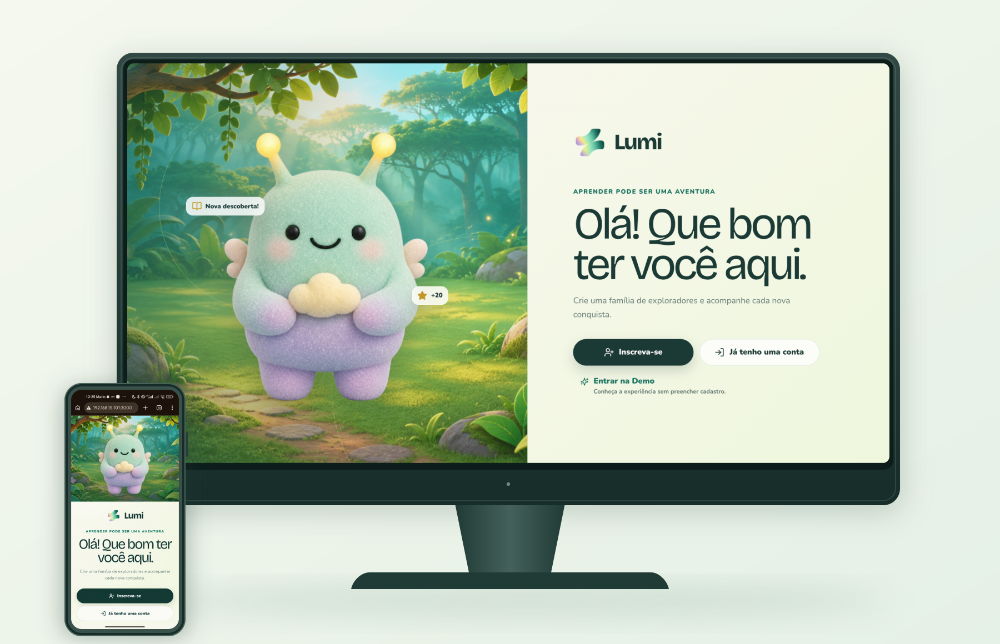
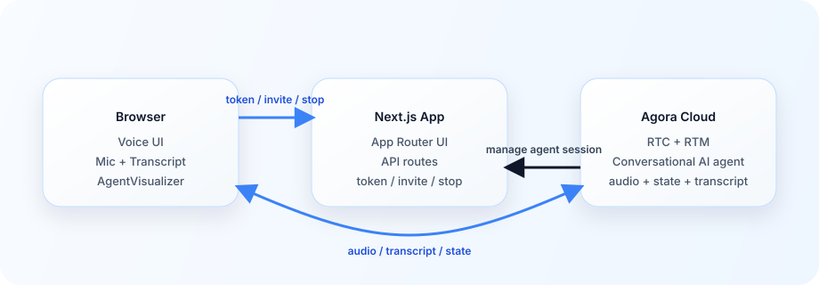

# Lumi — AI study companion for children

[](https://github.com/larianog/unmute-by-agora/actions/workflows/ci.yml)
[](./LICENSE)
[](https://nodejs.org/)

Lumi is a voice-first study companion that helps children work through school activities with guidance instead of simply giving them the answers. A child can upload a worksheet or photograph a page, choose their current reading level, and talk to Lumi about the activity in Brazilian Portuguese.

The experience is designed for families. Adults create the family account and child profiles, children study through their own profile, and responsible adults can review materials and completed activities in a protected progress area.

This repository is built from Agora's Conversational AI Next.js quickstart and extends it into a complete study-material workflow with multimodal analysis, family profiles, history, completion tracking, and a material-aware voice tutor.



## What Lumi does

A typical study session follows this path:

1. An adult creates a family account and adds one or more child profiles, or opens the built-in demo.
2. The child selects their profile and adds a school activity as a photo, image, or PDF.
3. The child selects how independently they currently read: not yet reading, reading with help, or reading independently.
4. The server validates the file and uses an OpenAI vision model to understand the worksheet.
5. Lumi identifies the subject, instructions, questions, expected answers, solution steps, and progressive hints.
6. The profile page opens the material workspace in place, and a private, material-aware voice agent guides the child through the activity. **Voltar ao perfil** returns to submission.
7. The child explicitly completes the activity. Its status then appears in the child's history and the adult progress report.

Lumi's tutoring prompt is adapted to the child's name, age, reading level, and uploaded activity. Expected answers remain server-side and are used only to check the child's reasoning; the child-facing extracted text does not expose the answer key.

## Run locally

### Prerequisites

- [Node.js 22 or newer](https://nodejs.org/en/download/)
- [pnpm](https://pnpm.io/installation)
- [Agora CLI](https://github.com/AgoraIO-Community/cli)
- An Agora project with Conversational AI enabled
- An OpenAI API key for worksheet analysis

### 1. Clone and install

```bash
git clone https://github.com/larianog/unmute-by-agora.git
cd unmute-by-agora
pnpm install
```

### 2. Install and authenticate the Agora CLI

macOS and Linux:

```bash
curl -fsSL https://raw.githubusercontent.com/AgoraIO/cli/main/install.sh | sh -s -- --add-to-path
```

Windows PowerShell:

```powershell
irm https://dl.agora.io/cli/install.ps1 | iex
```

Then authenticate and bind the repository to an Agora project:

```bash
agora login
agora project use <your-project>
agora project env write .env.local
```

### 3. Configure material analysis

After the Agora CLI writes `.env.local`, add the OpenAI key and optional material settings:

```dotenv
OPENAI_API_KEY=your_openai_api_key
# HOMEWORK_VISION_MODEL=gpt-4.1-mini
# LUMI_MATERIAL_RETENTION_HOURS=168
```

The complete tracked template is [`config/env/env.local.example`](config/env/env.local.example).

| Variable | Required | Purpose |
| --- | :---: | --- |
| `NEXT_PUBLIC_AGORA_APP_ID` | Yes | Public Agora project identifier used by the browser and server |
| `NEXT_AGORA_APP_CERTIFICATE` | Yes | Server-only Agora signing credential |
| `OPENAI_API_KEY` | Yes | Server-only credential for image/PDF material analysis |
| `HOMEWORK_VISION_MODEL` | No | Overrides the material model; defaults to `gpt-4.1-mini` |
| `LUMI_MATERIAL_RETENTION_HOURS` | No | File/text retention from 1 to 720 hours; defaults to 168 |
| `LUMI_RECORDING_RETENTION_HOURS` | No | Session-recording retention from 1 to 720 hours; defaults to 168 |

Never expose the Agora certificate or OpenAI key through `NEXT_PUBLIC_*` variables.

### 4. Verify and start

```bash
pnpm run doctor
pnpm run dev
```

Open [http://localhost:3000](http://localhost:3000). You can create a family account or choose the **Enter Demo** option to explore the built-in demo profiles.

If the voice agent does not join or transcripts do not appear, run:

```bash
agora project doctor --deep
```

## Features

### Child study experience

- Dedicated profiles for each child in a family.
- Camera capture and file upload from the study screen.
- Support for JPEG, PNG, WebP, and PDF files up to 10 MB.
- Reading-level selection that changes how Lumi reads and explains the activity.
- Structured worksheet understanding, including instructions, questions, visual elements, skills, steps, and hints.
- A live voice tutor grounded in the selected material.
- Progressive help that encourages the child to reason before receiving more guidance.
- Material history with processing, pending, failed, and completed states.
- Explicit activity completion instead of treating the end of a voice call as completion.

### Family and adult experience

- Family accounts with password-protected sessions.
- Multiple child profiles under one family.
- A protected adult area for reviewing progress and submitted materials.
- Per-child activity history and family-level reporting.
- A ready-to-use demo family for exploring the product without registration.

### Safety and reliability

- File type and binary-signature validation before analysis.
- A didactic-content check that keeps unrelated documents out of the child's study flow.
- Server-side material ownership checks before a voice agent can use extracted content.
- Cache reuse based on owner, profile, file hash, model, and prompt version.
- Private temporary file storage; uploads are never placed under `public/`.
- Child-safe material DTOs that do not expose private storage paths, hashes, or the server-only answer brief.
- Demo uploads isolated by browser session even though the demo family is shared.
- Automatic expiry of uploaded bytes and extracted text, with a seven-day default retention period.

Run `pnpm run verify` before shipping changes — it covers local prerequisites, lint, type safety, the core API route contracts, and the production build.
GitHub CI installs the pnpm version declared in `package.json`.

| Type | Accepted MIME type | Validation |
| --- | --- | --- |
| JPEG | `image/jpeg` | JPEG signature |
| PNG | `image/png` | PNG signature |
| WebP | `image/webp` | RIFF/WebP signature |
| PDF | `application/pdf` | `%PDF-` signature |

The Docker build definition and its context-specific ignore file live together under `deploy/docker/`:
The Dockerfile pins the same pnpm version as `package.json`.

- A child-safe transcription containing the activity title, instructions, and questions.
- A private tutoring brief containing expected answers, reasoning steps, hints, and pedagogical notes.

The private brief is loaded on the server when the voice session starts. Text supplied by the browser is never trusted as the grounding source.

## Architecture

Lumi is a single Next.js application containing the browser UI, server route handlers, voice-session orchestration, and local development persistence.

<picture>
  <source media="(prefers-color-scheme: dark)" srcset="./docs/assets/architecture/system-architecture-dark.svg">
  
</picture>

### Technology stack

| Layer | Technology | Responsibility |
| --- | --- | --- |
| Web application | Next.js 16 App Router, React 19, TypeScript | Pages, client state, API routes, and server rendering |
| Real-time audio | `agora-rtc-react`, `agora-rtc-sdk-ng` | Browser channel join, microphone track, and audio publication |
| Real-time events | `agora-rtm` | Transcript, agent state, metrics, and error events |
| Voice-agent client | `agora-agent-client-toolkit`, `agora-agent-uikit` | `AgoraVoiceAI`, turn state, transcript helpers, and voice UI |
| Voice-agent server | `agora-agents` | Managed agent creation, provider configuration, and session lifecycle |
| Material analysis | Vercel AI SDK and OpenAI | Structured multimodal analysis of images and PDFs |
| Local persistence | JSON metadata database and private filesystem cache | Families, profiles, sessions, completions, and temporary material content |

### Material-analysis pipeline

```text
Child profile
  -> POST /api/materials (authenticated multipart upload)
  -> ownership, size, MIME, and file-signature validation
  -> SHA-256 cache lookup
  -> OpenAI vision analysis with a strict structured schema
  -> child-safe extracted text + private tutoring brief
  -> private temporary storage + material metadata
  -> study workspace embedded on the profile page
```

The default material model is `gpt-4.1-mini`. The extraction result includes a didactic-content flag, title, subject, estimated grade, general instructions, up to 15 questions, expected answers, solution steps, and hints. Non-didactic files are associated with the adult profile rather than entering the child's tutoring flow.

### Voice-agent pipeline

The browser and the managed voice agent join the same Agora channel:

```text
Child microphone
  -> Agora RTC
  -> speech-to-text
  -> material-aware language model
  -> text-to-speech
  -> Agora RTC audio back to the child

Agent transcript, state, metrics, and errors
  -> Agora RTM
  -> browser UI
```

For uploaded study material, the browser sends multipart form data to `/api/materials` and opens the study workspace directly on the profile page, with a visible **Voltar ao perfil** control. The saved `/profile/:profileId/materials/:materialId` route remains available from history. Lumi starts an inline session grounded with server-loaded extracted text. The child explicitly completes the activity; ending the voice session alone does not mark it complete.
The default managed agent uses:

| Stage | Provider/model |
| --- | --- |
| Speech-to-text | Deepgram `nova-3`, Portuguese |
| Language model | OpenAI `gpt-4o-mini` |
| Text-to-speech | MiniMax `speech_2_6_turbo` |
| Optional visual avatar | LemonSlice, when configured |

Voice-session startup works as follows:

1. The browser requests a combined RTC + RTM token from `GET /api/generate-agora-token`.
2. The browser sends its channel, user ID, profile, and optional material IDs to `POST /api/invite-agent`.
3. The server verifies the family session and material ownership, then builds age-, literacy-, and worksheet-aware instructions.
4. The Agora managed agent joins the RTC channel and begins listening after voice activity is detected.
5. The browser publishes microphone audio and receives agent audio over RTC.
6. `AgoraVoiceAI` receives transcript, state, latency metrics, and errors over RTM.
7. `POST /api/stop-conversation` stops the managed session; React hooks own RTC and microphone cleanup.

The voice configuration uses server-side voice activity detection, bounded conversation history, interruption support, and a material-specific greeting. Agora-managed STT, LLM, and TTS do not require separate provider credentials in the default configuration. The `OPENAI_API_KEY` described below is used for material analysis.

### Data and security boundaries

- `NEXT_AGORA_APP_CERTIFICATE` and `OPENAI_API_KEY` are server-only secrets.
- The browser receives short-lived signed channel tokens, never the Agora certificate.
- Session tokens are stored in HTTP-only, same-site cookies.
- Uploaded files live in a private cache outside `public/`.
- Material access is scoped to the authenticated family and profile.
- Expected answers and tutoring notes never appear in list or child-facing material responses.
- Expired file/text content is purged lazily while completion metadata can remain available for history.

## Development commands

```bash
pnpm run dev          # start the local Next.js server
pnpm run lint         # run ESLint
pnpm run typecheck    # run TypeScript without emitting files
pnpm run verify:api   # verify API contracts
pnpm run build        # create a production build
pnpm run verify       # doctor + lint + typecheck + API checks + build
```

Run `pnpm run verify` before shipping changes. The `doctor` step requires a configured `.env.local`; lint, typecheck, API verification, and build can be run independently when live Agora credentials are unavailable.

## Main application routes

| Route | Purpose |
| --- | --- |
| `/` | Welcome, registration, sign-in, and demo entry |
| `/profiles` | Family profile selection and adult-area entry |
| `/profile/[id]` | Child study-material upload and embedded study workspace |
| `/profile/[id]/history` | Material history for one child |
| `/profile/[id]/materials/[materialId]` | Saved-material study workspace opened from history |
| `/report` | Adult family progress report with recorded sessions (audio, transcript, linked file, delete) |

## Main API routes

| Endpoint | Purpose |
| --- | --- |
| `POST /api/login` | Family or demo authentication |
| `POST /api/logout` | Sign out: deletes the server session and clears the cookie |
| `GET/POST /api/profiles` | Profile lookup; signup step 1 (parent account) and step 2 (one or more children) |
| `GET/POST /api/materials` | Material history and authenticated upload/analysis |
| `GET/PATCH /api/materials/[id]` | Authorized material detail and explicit completion |
| `GET /api/materials/[id]/file` | Authorized private material bytes |
| `GET/POST /api/recordings` | Adult list / child-session upload of session audio + transcript |
| `GET /api/recordings/[id]/file`, `DELETE /api/recordings/[id]` | Family-session playback (Range) and deletion |
| `GET /api/generate-agora-token` | Combined RTC + RTM browser token |
| `POST /api/invite-agent` | Material-aware managed voice-agent startup |
| `POST /api/stop-conversation` | Idempotent managed agent shutdown |

## Repository map

- `app/` — Next.js pages, layouts, global styles, and API routes.
- `components/` — product UI, upload flows, study pages, RTC/RTM lifecycle, and voice controls.
- `lib/db.ts` — local family, session, completion, and material metadata persistence.
- `lib/material-extraction.ts` — multimodal schema, prompt, sanitization, and child-safe transcript generation.
- `lib/material-storage.ts` — private temporary file storage.
- `lib/study-materials.ts` — ownership, demo isolation, browser-safe DTOs, and retention cleanup.
- `lib/conversation.ts` — transcript normalization and agent visual-state mapping.
- `app/api/invite-agent/route.ts` — tutor instructions, VAD, managed provider pipeline, and agent startup.
- `components/ConversationComponent.tsx` — RTC join, microphone publication, transcript/state events, metrics, and renewals.
- `config/env/env.local.example` — local environment template.
- `data/lumi-db.json` — local runtime database; its generated contents should not be committed.
- `deploy/docker/` — standalone container build.
- `docs/ai/` — progressive-disclosure architecture and maintenance documentation.

## Production and deployment

The repository can be deployed as a single Next.js application. A production deployment must configure the three required environment variables and keep both secrets server-side.

The included GitHub workflows provide:

- CI verification through [`.github/workflows/ci.yml`](.github/workflows/ci.yml).
- Production Vercel deployment through [`.github/workflows/deploy-vercel.yml`](.github/workflows/deploy-vercel.yml).
- Container verification through [`.github/workflows/docker.yml`](.github/workflows/docker.yml).

To build the standalone container locally:

```bash
docker build -f deploy/docker/Dockerfile -t lumi-by-agora .
```

The bundled JSON database and private filesystem cache are intended for local development or a persistent single-container deployment. They are not durable on serverless Vercel instances. Before a production launch, replace them with a persistent database and private object storage while preserving the ownership and retention boundaries in `lib/study-materials.ts`.

## Troubleshooting

- **Agent does not join:** verify the Agora environment with `pnpm run doctor` and inspect `/api/invite-agent`.
- **No transcript or agent state:** confirm the token route still uses `RtcTokenBuilder.buildTokenWithRtm`; an RTC-only token cannot authenticate RTM.
- **Material upload is rejected:** use a JPEG, PNG, WebP, or PDF whose contents match its declared type and is no larger than 10 MB.
- **Material analysis is unavailable:** confirm `OPENAI_API_KEY` is present in `.env.local` and restart the dev server.
- **The worksheet is unreadable:** upload a sharper photo taken from above with good lighting, or a shorter PDF containing only the activity pages.
- **Local data appears stale:** remember that file/text content expires according to `LUMI_MATERIAL_RETENTION_HOURS`, while metadata can remain for history.

## Further documentation

- [`AGENTS.md`](AGENTS.md) — contributor and coding-agent rules.
- [`docs/ai/L0_repo_card.md`](docs/ai/L0_repo_card.md) — repository identity and documentation index.
- [`docs/ai/RECIPE.md`](docs/ai/RECIPE.md) — quickstart extension points and invariants.
- [`docs/ai/L1/02_architecture.md`](docs/ai/L1/02_architecture.md) — runtime architecture.
- [`docs/ai/L1/L2/material_pipeline.md`](docs/ai/L1/L2/material_pipeline.md) — material ingestion and retention details.
- [`docs/ai/L1/L2/transcript_pipeline.md`](docs/ai/L1/L2/transcript_pipeline.md) — Agora transcript and RTM behavior.

## License

Released under the [MIT License](LICENSE).
