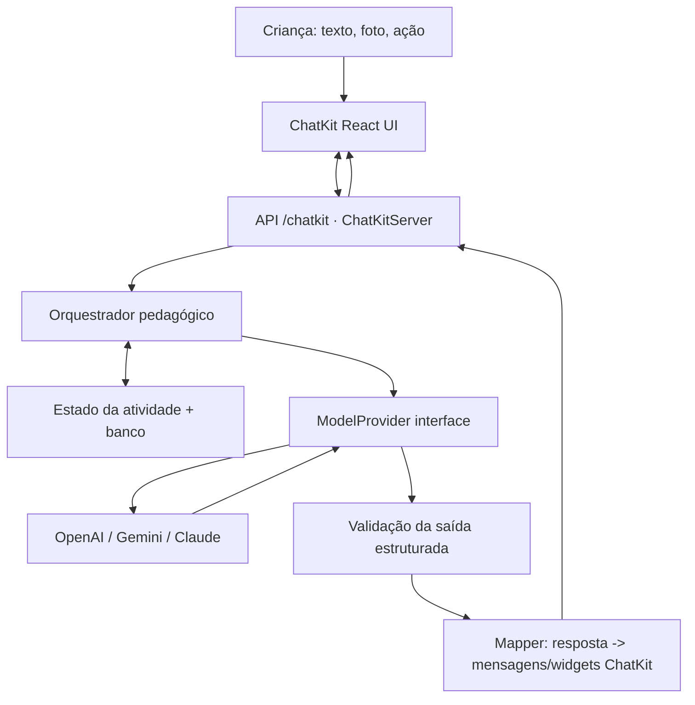

# Sofia — Especificação técnica de integração do ChatKit (MVP)

**Versão:** 1.0  
**Data:** 22/11/2026  
**Status:** proposta para implementação / validação técnica  
**Escopo:** adicionar uma interface de chat com widgets educacionais à Sofia (também referida como Lummiii em discussões anteriores), preservando a possibilidade de usar modelos de IA de múltiplos provedores.

## 1. Objetivo

Integrar **ChatKit como camada visual de conversação** a um backend controlado pela aplicação, capaz de consumir modelos de IA externos (OpenAI, Gemini, Claude ou outro), produzir intervenções pedagógicas guiadas e entregar mensagens ou widgets compatíveis com ChatKit.

O objetivo **não** é desenvolver um chatbot genérico: a criança envia uma foto da tarefa, recebe mediação guiada, tenta responder e avança **um exercício por vez**. O produto não entrega antecipadamente a solução da atividade.

### 1.1 Resultado esperado

- Chat renderizado com a identidade visual da Sofia e adaptado a dispositivos móveis.
- Envio de mensagem textual e foto da lição (sujeito à configuração de uploads do modo self-hosted).
- Respostas produzidas por provedor de IA configurável, sem depender de um fluxo OpenAI-hosted.
- Feedback, pistas e widgets educacionais na conversa.
- Persistência de sessão, exercício atual, tentativas e progresso.
- Regras pedagógicas, autorização, moderação e segurança executadas no backend.

### 1.2 Fora do escopo inicial

- Geração livre de HTML/JavaScript pelo modelo.
- Editor visual geral de atividades ou biblioteca ilimitada de widgets.
- Multiagentes, fine-tuning, RAG ou geração de novas ilustrações em toda resposta.
- Gamificação elaborada e relatórios completos para responsáveis.
- Voz em tempo real dentro do ChatKit: **não presumir suporte nativo ao canal de voz de baixa latência**; tratar voz como integração separada e validar o fluxo antes de incluí-lo no MVP.

## 2. Decisão arquitetural

**Escolha:** ChatKit JS/React no frontend + **ChatKit Python SDK self-hosted** no backend + adaptador desacoplado de modelos.

**Importante:** o ChatKit não é apenas um pacote de componentes React genéricos. A integração self-hosted exige implementar o protocolo e os eventos esperados pelo SDK, incluindo threads, itens, streaming, armazenamento e ações. A resposta de Gemini/Claude **não pode ser enviada diretamente** como se já fosse um widget do ChatKit: o backend deve adaptá-la ao formato aceito.



### 2.1 Responsabilidades

| Camada | Responsabilidade |
|---|---|
| ChatKit React | Interface de chat, apresentação das mensagens e widgets, entrada da criança, eventos de interação |
| ChatKitServer (Python) | Protocolo de threads/itens, streaming, recebimento de ações, persistência, contextos de requisição |
| Tutor Orchestrator | Seleção do exercício, política de pistas, avaliação de tentativas, controle de avanço |
| Model Provider | Chamar o provedor de LLM/visão e normalizar retorno e erros |
| Output Validator | Aplicar schema, filtros, restrições pedagógicas e validações de segurança |
| Widget Mapper | Converter objetos pedagógicos normalizados para widgets realmente suportados pelo ChatKit |
| Session Store | Armazenar apenas dados necessários com segregação por responsável e criança |

## 3. Stack sugerida

- **Frontend:** React/Next.js ou frontend atual da Sofia, `@openai/chatkit-react`.
- **ChatKit JS:** script/runtime e opções de configuração conforme documentação da versão instalada.
- **Backend:** Python 3.11+, FastAPI, `openai-chatkit`.
- **Modelos:** interface `TutorModelProvider`; implementação inicial com o provedor já utilizado pelo produto.
- **Validação:** Pydantic; schemas próprios de saída pedagógica.
- **Persistência:** PostgreSQL em produção; store de desenvolvimento apenas para protótipo local.
- **Observabilidade:** logs estruturados com dados pessoais minimizados; métricas de latência, erro, pistas e progresso.
- **Segredos:** variáveis de ambiente/backend; nunca expor chaves dos provedores ao navegador.

> Consultar os quickstarts oficiais para APIs e dependências exatas; a configuração de ChatKit e o formato dos eventos podem mudar entre versões.

## 4. Dependências e início rápido

### 4.1 Instalação

```bash
# Frontend
npm install @openai/chatkit-react

# Backend
pip install openai-chatkit fastapi uvicorn pydantic
```

No frontend, a integração self-hosted aponta para a API da Sofia:

```tsx
import { ChatKit, useChatKit } from '@openai/chatkit-react';

export function SofiaChat() {
  const chatkit = useChatKit({
    api: {
      url: '/chatkit',
      domainKey: 'local-dev', // apenas exemplo local; configurar o domínio em produção
    },
  });

  return <ChatKit control={chatkit.control} />;
}
```

**Nota:** exemplo simplificado baseado na documentação do SDK. A instalação/configuração do runtime ChatKit JS, autenticação, upload de arquivos, tema e domínio precisam seguir o guia atualizado.

O backend deve implementar um `ChatKitServer` com `respond(...)`, um store e uma rota FastAPI que encaminhe requisições ao servidor. **Não** construir uma rota HTTP arbitrária que retorne apenas JSON livre e esperar que o ChatKit a interprete automaticamente.

### 4.2 Ponto de partida recomendado

```bash
git clone https://github.com/openai/openai-chatkit-starter-app.git
```

Usar o starter oficial como referência para integração React + Python e substituir a lógica de geração de mensagens pelo `TutorOrchestrator`.

## 5. Contrato interno de saída pedagógica

A IA retorna **dados pedagógicos**, não componentes brutos nem código executável. Exemplo de estrutura interna ilustrativa (não é o schema nativo de widgets do ChatKit):

```json
{
  "schema_version": "1.0",
  "exercise_id": "exercise_001",
  "attempt_result": "correct",
  "pedagogical_action": "reinforce_and_ask",
  "message": "Muito bem! Você identificou a figura. Agora observe a próxima.",
  "hint_level": 0,
  "progress": { "completed": 3, "total": 10 },
  "ui_blocks": [
    { "type": "progress", "completed": 3, "total": 10 },
    { "type": "word_highlight", "words": ["canguru", "carro"], "highlight_index": 2 }
  ],
  "next_question": "Qual letra vem antes no alfabeto?",
  "exercise_completed": false,
  "allow_advance": false
}
```

### 5.1 Regras de validação

- O exercício corrente e o progresso autoritativo vêm do servidor, não do LLM.
- `ui_blocks.type` deve pertencer a uma lista permitida.
- Propriedades tipadas, comprimento de mensagens e quantidade de widgets devem ter limites.
- O retorno não pode fornecer scripts, HTML arbitrário ou URLs externas não aprovadas.
- O backend verifica se `allow_advance` está consistente com a conclusão real do exercício.
- Quando a saída estiver inválida, responder com texto seguro e registrar erro técnico sem expor dados da criança.

### 5.2 Interface de modelo

```python
from typing import Protocol

class TutorModelProvider(Protocol):
    async def generate(self, context: dict) -> dict:
        """Retorna o contrato pedagógico normalizado."""
        ...

class TutorOrchestrator:
    def __init__(self, model: TutorModelProvider):
        self.model = model

    async def handle_attempt(self, session: dict, user_input: dict) -> dict:
        # 1. Checar sessão, usuário, exercício ativo e política de segurança
        # 2. Preparar contexto mínimo e chamar modelo
        # 3. Validar a saída pedagógica
        # 4. Persistir tentativa e atualizar progresso apenas se autorizado
        # 5. Entregar resposta ao mapper de widgets ChatKit
        raise NotImplementedError
```

Essa abstração permite trocar de provedor sem alterar a UI. Cada provedor terá suas próprias garantias/limitações de saída estruturada e política de dados.

## 6. Widgets educacionais do MVP

Começar por **composições dos widgets oficialmente suportados** pelo ChatKit, em vez de supor que qualquer componente React funcionará dentro da conversa.

| Widget pedagógico | Comportamento | Estratégia ChatKit | Prioridade |
|---|---|---|---|
| `ProgressCard` | `3 de 10`, barra textual/visual ou indicador equivalente | Card + textos/composição suportada; validar se barra visual nativa é possível | P0 |
| `WordComparison` | Apresentar palavras e destacar letras | Card, Row, Text; verificar limites de estilos por segmento | P0 |
| `AlphabetReference` | Mostrar alfabeto de referência | Card/linhas de texto ou composição compatível | P0 |
| `HintCard` | Uma pista breve por vez | Card + textos/ícone | P0 |
| `ChoicePrompt` | Resposta por opções ou entrada | Buttons / Form / Input + action server-side | P0 |
| `VisualReference` | Exibir uma imagem aprovada | Image dentro de widget suportado | P1 |
| `ObjectCounter` | Agrupar objetos ilustrados para contar | Composição de imagem/texto; avaliar legibilidade | P1 |

**Restrições:** progresso animado, letras com formatação granular, drag-and-drop, canvas livre e widgets React arbitrários podem não ser atendidos pelos componentes nativos. Nesses casos, simplificar a composição ou renderizar a atividade em um painel React **fora** do corpo da mensagem, sincronizado com o estado da sessão.

### 6.1 Criação de widgets

- Criar templates no **ChatKit Widget Studio** (`https://widgets.chatkit.studio`).
- Exportar o arquivo `.widget` e versioná-lo no repositório.
- Preencher os dados no backend (por exemplo via `WidgetTemplate`, conforme versão do SDK).
- Emitir widgets como eventos no método `respond`.
- Tratar `actions` recebidas no backend e validar permissões antes de alterar o progresso.

## 7. Fluxo principal — foto da lição

1. Responsável autoriza a sessão; criança acessa ambiente com controles adequados.
2. Criança envia foto de uma tarefa.
3. Upload recebe validação de formato, tamanho, conteúdo e tratamento de dados pessoais.
4. Serviço de visão tenta identificar enunciados, figuras e exercícios; se houver ambiguidade, solicita nova foto ou confirmação.
5. Orquestrador cria a lista de exercícios e seleciona **apenas o primeiro pendente**.
6. Sofia faz **uma pergunta por vez** sem revelar a solução.
7. Criança responde; o backend registra uma tentativa.
8. Modelo e regras pedagógicas analisam a tentativa; acerto recebe reforço breve, erro recebe uma pista graduada.
9. Widget de progresso reflete somente exercícios realmente concluídos.
10. Apenas após conclusão do exercício ativo o orquestrador permite avançar.

### 7.1 Estados de exercício

`NOT_STARTED -> IN_PROGRESS -> COMPLETED`

Estados adicionais: `NEEDS_CLARIFICATION`, `BLOCKED`, `SKIPPED_BY_GUARDIAN` (se o produto admitir). Evitar que o modelo avance por conta própria.

### 7.2 Política de pistas

- **Nível 0:** pergunta exploratória, recuperação de conhecimento prévio.
- **Nível 1:** orientar a observação de uma característica relevante.
- **Nível 2:** apresentar referência visual ou decompor a tarefa.
- **Nível 3:** exercício análogo mais simples, mantendo a resposta original em aberto.
- **Persistência de dificuldade:** oferecer nova abordagem ou sugerir ajuda de um responsável, sem revelar automaticamente a resposta da atividade.

## 8. Política pedagógica de sistema

```text
Você é a Sofia, tutora virtual de apoio à aprendizagem de crianças de 6 a 10 anos.
Seu papel é promover autonomia, raciocínio e compreensão.

- Trabalhe somente no exercício ativo enviado pelo backend.
- Não entregue respostas de exercícios que a criança ainda não resolveu.
- Faça uma pergunta principal por interação.
- Aguarde a tentativa antes de avançar.
- Ao detectar erro, ofereça uma pista progressiva e não a resposta pronta.
- Ao detectar acerto, confirme brevemente e explique o raciocínio.
- Não confunda incentivo emocional com validação automática de uma resposta errada.
- Prefira vocabulário simples, tom acolhedor e respostas curtas.
- Se o texto ou a figura estiver ilegível, solicite esclarecimento.
- Sugira componentes visuais apenas quando ajudarem no objetivo pedagógico.
- Nunca altere o progresso ou a permissão de avanço: são decisões do servidor.
```

Este prompt **não é uma garantia técnica**. É indispensável avaliar casos de vazamento de resposta e manter regras fora do modelo.

## 9. Sessão e dados

### 9.1 Entidades propostas

- `guardian`: identificador pseudonimizado, consentimentos, preferências de privacidade.
- `learner`: identificador pseudonimizado, faixa etária, vínculo ao responsável.
- `learning_session`: ID, learner_id, status, início/fim.
- `exercise`: ID, session_id, posição, enunciado processado, status.
- `attempt`: exercise_id, índice, resultado, nível de pista (evitar armazenar texto integral por padrão).
- `chat_thread_mapping`: vínculo entre thread do ChatKit e sessão da Sofia.

### 9.2 Segurança operacional

- Autenticação e autorização para qualquer thread, arquivo ou action.
- Garantir isolamento entre diferentes famílias/crianças.
- Chaves de APIs apenas no servidor; controles de rate limiting, timeout e retries.
- Limites de upload, varredura de arquivos e remoção/ocultação de dados identificadores.
- Políticas de retenção mínima, exclusão e acesso restrito aos dados.
- Revisão específica de proteção à criança, LGPD e condições do provedor antes de uso real.
- Não presumir que a configuração self-hosted do ChatKit elimina exposição de dados ao provedor de inferência.
- Verificar requisitos de **Zero Data Retention** e regras para informações pessoais de menores de 13 anos quando a OpenAI API for usada.

## 10. Tratamento de erros e fallback

| Situação | Comportamento |
|---|---|
| Modelo indisponível ou timeout | Mensagem curta de erro e opção de tentar novamente; sem duplicar tentativas |
| Retorno fora do schema | Tentar normalização limitada; usar resposta segura textual se falhar |
| Widget incompatível | Renderizar alternativa textual acessível |
| Imagem ilegível | Pedir nova foto ou descrição, sem inferir dados faltantes |
| Action duplicada | Idempotência por ID de ação/tentativa |
| Resposta insegura | Bloquear conteúdo e oferecer continuação apropriada |
| Provedor trocado | Manter contrato pedagógico, testar compatibilidade antes de ativar |

## 11. API, streaming e ações

- **Endpoint principal:** `/chatkit` no backend, implementado com o protocolo oficial do ChatKit SDK.
- **Transporte de resposta:** eventos de streaming do SDK; não inventar eventos incompatíveis com a versão instalada.
- **Ações:** `submit_answer`, `request_hint` e `repeat_instruction` são **nomes de domínio sugeridos**; mapear para mecanismos de action documentados no ChatKit.
- **Estado externo:** se houver painel de exercício fora do ChatKit, sincronizar mudanças com backend e componentes React próprios.
- **Upload:** seguir a estratégia de arquivos da versão utilizada e definir limites explícitos no backend.

## 12. Estrutura proposta do repositório

```text
sofia/
├── frontend/
│   ├── components/SofiaChat.tsx
│   ├── components/ExercisePanel.tsx     # opcional, fora da mensagem
│   └── styles/chatkit-theme.css
├── backend/
│   ├── app/main.py
│   ├── app/chatkit/server.py
│   ├── app/chatkit/store.py
│   ├── app/chatkit/widget_mapper.py
│   ├── app/chatkit/widgets/*.widget
│   ├── app/tutor/orchestrator.py
│   ├── app/tutor/prompts.py
│   ├── app/tutor/schemas.py
│   ├── app/providers/base.py
│   ├── app/providers/openai.py
│   ├── app/providers/gemini.py
│   ├── app/providers/claude.py
│   └── tests/
└── docs/
    └── sofia-chatkit-mvp-specs.md
```

## 13. Plano de implementação

### Etapa 1 — Spike técnico (P0)

- [ ] Executar starter oficial ChatKit com React + Python.
- [ ] Usar backend self-hosted e `ChatKitServer`, com mensagens hardcoded.
- [ ] Exibir uma mensagem do modelo externo já adotado no projeto.
- [ ] Comprovar stream de texto e histórico da conversa.
- [ ] Validar upload de foto e sua passagem ao provedor de visão.
- [ ] Avaliar limitações dos widgets educacionais previstos.

**Critério de aprovação:** é possível conversar, enviar foto, receber resposta de modelo externo e exibir ao menos um widget nativo via backend próprio.

### Etapa 2 — Integração pedagógica (P0)

- [ ] Adicionar `TutorModelProvider` e contrato interno estruturado.
- [ ] Implementar fluxo de um exercício por vez.
- [ ] Criar `HintCard`, `WordComparison`, `AlphabetReference`, `ProgressCard`.
- [ ] Validar respostas do modelo antes de transformá-las em eventos/widgets.
- [ ] Persistir estado, tentativas e progresso no servidor.
- [ ] Implementar ações idempotentes e fallback textual.

### Etapa 3 — Experiência com criança (P0, antes de piloto)

- [ ] Ajustar tipografia, responsividade e acessibilidade.
- [ ] Verificar se cards funcionam em telas pequenas e com leitor de tela.
- [ ] Testar segurança e privacidade infantil com dados sintéticos.
- [ ] Implementar gestão de consentimento e retenção apropriada.
- [ ] Testar fala/voz em integração separada **somente se for essencial ao escopo**.

### Etapa 4 — Avaliação do produto (P1)

- [ ] Medir número de pistas por exercício.
- [ ] Medir taxa de conclusão sem intervenção humana.
- [ ] Aplicar exercício similar depois da tutoria, sem pistas.
- [ ] Medir quantidade de respostas indevidamente reveladas.
- [ ] Coletar feedback de pais e educadores.

## 14. Critérios de aceite (Definition of Done)

1. O frontend ChatKit conversa com um backend Python self-hosted próprio.
2. A resposta vem de um provedor de modelo intercambiável.
3. Foto de atividade chega de forma validada ao pipeline de visão.
4. No mínimo quatro widgets educacionais aparecem adequadamente, com fallback acessível.
5. A ação de um botão retorna ao backend e altera apenas o estado permitido.
6. Após erro da criança, o tutor oferece pista sem entregar solução.
7. A criança não avança para o exercício seguinte antes de concluir o atual.
8. Recarregar a página preserva o estado permitido da sessão.
9. O backend rejeita dados inválidos, ações não autorizadas e duplicações.
10. Requisitos de segurança e privacidade para piloto com crianças foram revisados e implementados.

## 15. Experimento de referência (teste end-to-end)

**Atividade:** ordenar palavras alfabeticamente a partir de uma foto com figuras.

**Roteiro:**

1. Enviar uma imagem de tarefa contendo dez figuras.
2. Tutor identificar as figuras gradualmente, uma por vez, sem enumerar soluções antes das tentativas.
3. A cada acerto, atualizar o indicador de progresso.
4. Depois da identificação, apoiar a ordem alfabética com referência visual.
5. Quando duas palavras começarem pelas mesmas letras, usar widget de comparação.
6. Registrar conclusão e medir total de pistas.
7. Oferecer outra comparação, sem ajuda, para verificar transferência de aprendizado.

**Falhas críticas:** revelar resposta antes da tentativa, avançar sozinho, confundir elementos da imagem, perder o estado ou mostrar widget inacessível sem alternativa textual.

## 16. Documentação consultada

- ChatKit JS: https://openai.github.io/chatkit-js/
- ChatKit JS Quick Start: https://openai.github.io/chatkit-js/quickstart/
- ChatKit Python SDK: https://openai.github.io/chatkit-python/
- ChatKit Python Quick Start: https://openai.github.io/chatkit-python/quickstart/
- Responder a mensagens (ChatKitServer): https://openai.github.io/chatkit-python/guides/respond-to-user-message/
- Widgets interativos: https://openai.github.io/chatkit-python/guides/build-interactive-responses-with-widgets/
- Widget Studio: https://widgets.chatkit.studio/
- ChatKit API guide: https://developers.openai.com/api/docs/guides/chatkit
- Widgets API guide: https://developers.openai.com/api/docs/guides/chatkit-widgets
- Starter oficial: https://github.com/openai/openai-chatkit-starter-app

---

**Observação de implementação:** os trechos de código e o JSON pedagógico são exemplos de integração e design interno, **não** constituem um servidor completo nem substituem o formato de eventos do ChatKit. Confirmar assinaturas e funcionalidades exatas contra a versão travada das bibliotecas antes de implementar.
